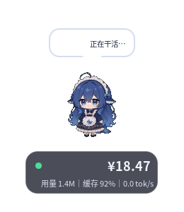

# ds-linux-balance-pet

本项目参考并移植自 [yzcjdxmx/codex-balance-pet](https://github.com/yzcjdxmx/codex-balance-pet)。原项目是 Windows/PowerShell 桌宠；本项目将其中的余额桌宠交互重写为 Ubuntu 22.04 可用的 Python + GTK3 版本，并专注于轻量、无 Electron/Node/DSH 依赖的 DeepSeek 余额显示。

> 本项目是非官方同人项目，与 DeepSeek、OpenAI、Codex 及参考项目作者均无隶属或背书关系。



## 特性

- **DeepSeek 余额直连**：读取 `GET /user/balance`，默认 30 秒刷新；支持低余额阈值、错误状态、余额日志和余额报告。
- **两种形象模式**
  - **紧凑动画模式**：接入 15 个 dsh-pet 核心动画，待机、点击、拖拽、工作中的思考/忙碌、任务完成、错误、余额分档、打盹和问候。
  - **经典形象模式**：保留参考项目的 19 个静态形象、眨眼、写字动画和状态表情。
- **轻量运行时**：Python 3.10 + GTK3 + Cairo + GdkPixbuf；不依赖 Electron、Node、GStreamer、DSH 或运行时视频解码器。
- **桌面行为**：逐像素透明、透明区域点击穿透、置顶、不抢焦点、拖动、位置记忆、单实例。
- **启动缩放**：`--scale 0.3` 可把整个窗口缩放到 30%；配置可长期保存。
- **用量与任务**：只读解析 Codex 会话日志和任务数据库；任务运行时显示写字/工作动画，任务结束后恢复。
- **报告**：把余额日志汇总为终端表格和 PNG 曲线图。
- **默认不自动启动**：源码安装和 deb 都不会写入登录自启项。

## 系统要求

- Ubuntu 22.04（也适用于相近的 Debian/Ubuntu 桌面）
- X11 或 XWayland 会话
- Python 3.10+
- GTK3 / PyGObject / Cairo / GdkPixbuf
- 中文字体 `fonts-noto-cjk`

本项目强制使用 XWayland 风格的 X11 窗口（`GDK_BACKEND=x11`）。原生 Wayland 不支持完整的跨应用置顶、任意定位和透明区域点击穿透，因此不建议在纯原生 Wayland 下使用。

## 安装 deb

从 Release 下载 `ds-linux-balance-pet_0.1.0_all.deb` 后：

```bash
sudo apt install ./ds-linux-balance-pet_0.1.0_all.deb
```

安装后 `postinst` 会打印配置说明。首次设置：

```bash
ds-linux-balance-pet --set-key
ds-linux-balance-pet --scale 0.3
ds-linux-balance-pet --mode compact
```

启动：

```bash
ds-linux-balance-pet
```

也可以从应用菜单启动「余额桌宠」。默认不会开机自启。

卸载：

```bash
sudo apt remove ds-linux-balance-pet
```

用户配置、余额记录不会被卸载程序删除。

## 从源码运行

```bash
git clone https://github.com/KunyangWu/ds-linux-balance-pet.git
cd ds-linux-balance-pet

./linux/run.sh --set-key
./linux/run.sh --scale 0.3
./linux/run.sh
```

安装到当前用户目录：

```bash
./linux/install.sh
# 可选：./linux/install.sh --autostart
```

卸载源码安装：

```bash
./linux/install.sh --uninstall
```

## 配置

配置文件：

```text
~/.config/ds-linux-balance-pet/config.json
```

状态和余额记录：

```text
~/.local/state/ds-linux-balance-pet/pet-state.json
~/.local/state/ds-linux-balance-pet/balance-log.csv
```

常用字段：

| 字段 | 默认值 | 说明 |
|---|---|---|
| `api_key` | 空 | DeepSeek API Key；`DEEPSEEK_API_KEY` 环境变量优先 |
| `base_url` | `https://api.deepseek.com` | API 基础地址 |
| `balance_url` | 空 | 自定义 `/user/balance` 地址；留空由 `base_url` 拼接 |
| `scale` | `1.0` | 统一启动缩放，范围 0.1–3.0 |
| `animation_mode` | `compact` | `compact` 或 `classic` |
| `compact_scale_factor` | `1.6` | 紧凑模式相对经典模式的缩放系数；默认让两种模式窗口面积接近 |
| `low_threshold` | 空 | 低余额提醒阈值；只对 `low_currency` 生效 |
| `low_currency` | `CNY` | 阈值币种 |
| `refresh_seconds` | `30` | 余额刷新秒数 |
| `idle_sleep_seconds` | `150` | 闲置多久打盹 |
| `log_interval_seconds` | `1800` | 余额日志写入间隔 |
| `show_stats` | `true` | 是否显示用量行 |
| `topmost` | `true` | 是否置顶 |
| `no_activate` | `true` | 启动时是否不抢焦点 |

示例：

```json
{
  "api_key": "sk-...",
  "scale": 0.3,
  "animation_mode": "compact",
  "low_threshold": 20,
  "refresh_seconds": 30
}
```

**不要把真实 Key 提交到 GitHub。** 配置文件权限会自动设置为 600；也可以只使用环境变量：

```bash
export DEEPSEEK_API_KEY="sk-..."
ds-linux-balance-pet
```

## 缩放

临时启动：

```bash
ds-linux-balance-pet --scale 0.3
```

长期生效：

```json
{
  "scale": 0.3
}
```

缩放会同时作用于立绘/动画、余额牌、气泡和透明点击区域；右键菜单和设置对话框保持正常大小。改变缩放比例或紧凑模式系数后，窗口会回到右下角；同一个 effective scale 下会沿用上次位置。

紧凑模式默认额外乘 `1.6`，所以：

- `--scale 1.0`：经典约 `340×594`，紧凑约 `416×480`
- `--scale 0.3`：经典约 `102×178`，紧凑约 `125×144`

两者的窗口面积接近；GIF 内角色原始尺寸较小，所以角色本体仍会略小于经典模式。可以在配置中调整 `compact_scale_factor`。

## 动画模式

- **紧凑动画模式**：默认模式，使用 `linux/assets/dsh-pet/` 下的 15 个 GIF，画布约 260×300。
- **经典形象模式**：使用 `linux/assets/` 下的 19 个静态形象，保留原有的状态和写字动画。

切换：

```bash
ds-linux-balance-pet --mode classic
ds-linux-balance-pet --mode compact
```

也可以在右键菜单里切换。

## 余额报告

```bash
ds-linux-balance-pet-report
# 或源码目录：
python3 tools/balance_report.py
```

默认读取 `~/.local/state/ds-linux-balance-pet/balance-log.csv`，输出 PNG 到同目录的 `reports/`。

## 隐私与数据

- 余额查询只访问你配置的 DeepSeek/兼容余额接口。
- Codex 用量和任务功能只读取 `~/.codex/sessions`、`~/.codex/state_5.sqlite` 和 `~/.codex/thread_history_1.sqlite`，不修改 Codex 数据。
- 不发送遥测，不上传余额、用量或屏幕内容。
- API Key 不写入日志、状态文件或余额记录。

## 已知限制

- 只支持 DeepSeek 余额；不包含官方 ChatGPT/Codex 额度模式和重置倒计时。
- 不包含 Codex 插件、MCP 服务或自动随 Codex 启停。
- 原生 Wayland 下无法可靠实现完整桌宠窗口行为，请使用 X11/XWayland。
- 紧凑动画使用 dsh-pet 的 220×124 预览 GIF，画质和帧率低于原始 640×360 WebM；这是为了不引入 GStreamer 和额外运行时依赖。
- `0.3` 缩放下文字会比较小，建议按实际屏幕尝试 `0.3`–`0.6`。
- 立绘和动画素材有单独的版权/许可限制，见下一节。

## 许可与第三方素材

**代码**：MIT，见 [`LICENSE`](LICENSE)。

- 原项目 `yzcjdxmx/codex-balance-pet`：MIT
- Linux 移植部分：MIT（版权人 `KunyangWu`）

**经典立绘**：来自参考项目的非官方 DeepSeek 表情包素材，版权归原作者，**不属于 MIT 授权范围**；仅作为示例提供。

**dsh-pet 动画**：来自 [PC2005-cloud/dsh-pet](https://github.com/PC2005-cloud/dsh-pet) 的选取预览 GIF，使用 **CC BY-NC-SA 4.0**：必须署名、不得商业使用、修改后以相同方式共享。完整说明见 [`THIRD_PARTY_NOTICES.md`](THIRD_PARTY_NOTICES.md) 和 `linux/assets/dsh-pet/NOTICE.md`。

因此：

- 代码可以按 MIT 使用；
- 包含上述素材的整个 deb/发行包不能用于商业用途；
- 如果要商业分发，必须替换经典立绘和 dsh-pet 动画，或取得权利人单独授权。

## 开发与测试

```bash
PYTHONPATH=linux python3 -m unittest discover -s tests
./linux/run.sh --preview
./packaging/build-deb.sh
```

构建 deb 需要 `debhelper`、`dpkg-buildpackage` 和 X11/XWayland 预览环境；构建结果输出到 `dist/`。

## 发布前检查

- 不要把 `~/.config/ds-linux-balance-pet/config.json`、`balance-log.csv`、`pet-state.json` 或任何 API Key 提交到仓库。
- 确认 `LICENSE`、`debian/control`、`debian/copyright` 中的维护者信息和 Homepage 正确。
- 保留参考项目链接和原始 MIT 版权声明；不要删除 `THIRD_PARTY_NOTICES.md`。
- 项目代码是 MIT，但经典立绘和 dsh-pet 动画不是 MIT；发布说明里不要写成“全部 MIT”。
- 如果要商业分发，先替换立绘和动画，或取得权利人授权。
- deb 放在 GitHub Releases，`dist/`、构建缓存和密钥文件不要提交。

## 参考项目

- 主要参考：[yzcjdxmx/codex-balance-pet](https://github.com/yzcjdxmx/codex-balance-pet)
- 紧凑动画素材：[PC2005-cloud/dsh-pet](https://github.com/PC2005-cloud/dsh-pet)

如果你 fork 或二次发布，请保留参考项目链接、原 MIT 版权声明和素材署名。
